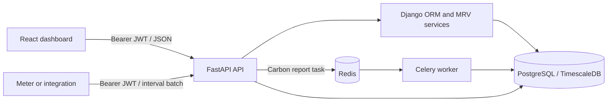

# MRV CleanTech Platform

## Project structure

```text
.
├── config/                 # Django settings, WSGI, Celery application
├── frontend/               # React + TypeScript command center dashboard
├── ingestion/              # FastAPI IoT ingestion service
├── mrv/                    # Tenant, meter, time-series models and domain services
│   ├── migrations/         # PostgreSQL and TimescaleDB schema
│   ├── models.py
│   ├── services.py
│   └── tasks.py
├── docker/
│   ├── Dockerfile.django
│   └── Dockerfile.fastapi
├── docker-compose.yml
├── manage.py
└── requirements.txt
```

## Run

Before starting in a non-debug environment, replace the secret placeholders in
`.env.example` with strong, unique `DJANGO_SECRET_KEY` and `JWT_SECRET_KEY`
values. The API refuses to start with placeholder or short signing keys when
`DJANGO_DEBUG=false`.

```bash
docker compose up --build
```

Django is available on `http://localhost:8000`; the MRV command center is available on `http://localhost:3000`; ingestion is available on `http://localhost:8001`.

The dashboard uses live API data when a tenant has readings. With an empty database it renders a clearly labeled demo workspace so the interface can be evaluated immediately.

For frontend-only development:

```bash
cd frontend
npm install
npm run dev
```

The FastAPI Swagger contract is available at `http://localhost:8001/docs`.
For local API development with PostgreSQL and Redis already running, apply
migrations with `python manage.py migrate`, then start FastAPI with
`python -m uvicorn ingestion.main:app --reload --port 8001`. Django's
`runserver` on port `8000` is not the public API server.

## API and system architecture

The public HTTP API is served by FastAPI on port `8001`. Django supplies the
domain models and ORM; PostgreSQL/TimescaleDB stores tenant, meter, and
15-minute reading data. Redis queues carbon report jobs for Celery workers.
The React dashboard authenticates with the API and uses tenant-scoped
endpoints.



### Authentication and setup

Except for `GET /health`, `POST /v1/auth/register`, and `POST /v1/auth/login`,
API routes require `Authorization: Bearer <access_token>`. Access tokens expire
after one hour. Registration creates a user and an initial tenant; a user can
only read or modify tenants to which they belong. Passwords are validated with
Django's password validators. Meter deactivation is soft, preserving reading
history.

This initial auth flow issues access tokens only; password reset, email
verification, refresh/revocation, member invitations/roles, and login
rate-limiting need to be added before exposing registration to the public
internet. Workspace membership can currently be assigned by the trusted
management command.

Set strong, unique secrets in `.env` before starting the services. Do not use
the placeholder values from `.env.example`:

```dotenv
DJANGO_SECRET_KEY=<strong-random-secret>
JWT_SECRET_KEY=<strong-random-secret>
DJANGO_DEBUG=false
DJANGO_ALLOWED_HOSTS=localhost,127.0.0.1
CORS_ORIGINS=http://localhost:3000,http://localhost:5173
```

For a deployed dashboard, set `DJANGO_ALLOWED_HOSTS` and `CORS_ORIGINS` to
the actual hostnames/origins rather than using the local defaults.

For example, generate each value with `python -c "import secrets; print(secrets.token_urlsafe(48))"`.

Register a workspace and receive its access token:

```http
POST /v1/auth/register
Content-Type: application/json

{
  "email": "operator@example.com",
  "password": "a-long-unique-password",
  "tenant_name": "Northstar Metals",
  "grid_emission_factor_kgco2_per_kwh": "0.4"
}
```

Sign in later with `POST /v1/auth/login` and the same `email` and `password`.
The response includes an `access_token` and `token_type: "bearer"`.

### Endpoint reference

All tenant-specific requests use a tenant UUID and enforce membership for the
authenticated user. JSON responses represent energy and emissions decimals as
strings where precision should be retained.

| Method | Endpoint | Purpose |
| --- | --- | --- |
| `GET` | `/health` | Liveness check |
| `POST` | `/v1/auth/register` | Create a user and their first tenant |
| `POST` | `/v1/auth/login` | Issue an access token |
| `GET` | `/v1/auth/me` | Return the current user and their tenants |
| `GET`, `POST` | `/v1/tenants` | List or create tenants |
| `GET`, `PATCH` | `/v1/tenants/{tenant_id}` | Retrieve or update tenant details and grid factor |
| `GET`, `POST` | `/v1/tenants/{tenant_id}/meters` | List or register meters |
| `PATCH`, `DELETE` | `/v1/tenants/{tenant_id}/meters/{meter_id}` | Update or deactivate a meter |
| `GET`, `POST` | `/v1/energy/readings` | Query paginated readings or ingest a batch |
| `GET` | `/v1/dashboard/overview` | Tenant summary and interval chart series |
| `POST` | `/v1/reports/carbon` | Queue a UTC daily/monthly carbon report |
| `GET` | `/v1/reports?tenant_id={uuid}` | List recent report jobs |
| `GET` | `/v1/reports/{report_id}` | Read report-job status and completed result |
| `GET` | `/v1/forecasts/energy?tenant_id={uuid}` | Forecast the next 1–168 hours |

Meter registration example:

```http
POST /v1/tenants/{tenant_id}/meters
Authorization: Bearer <access_token>
Content-Type: application/json

{
  "external_id": "plant-01",
  "name": "Plant 01",
  "meter_type": "bidirectional"
}
```

Reading ingestion example:

```http
POST /v1/energy/readings
Authorization: Bearer <access_token>
Content-Type: application/json

{
  "tenant_id": "<tenant-uuid>",
  "meter_external_id": "plant-01",
  "readings": [
    {
      "timestamp": "2026-10-21T12:00:00Z",
      "energy_consumed_kwh": "18.25",
      "energy_generated_kwh": "6.5",
      "quality": "measured"
    }
  ]
}
```

Readings are bulk-upserted by tenant, meter, and timestamp. Timestamps must
include a timezone, values must be non-negative, and a request cannot include
the same instant more than once. `GET /v1/energy/readings` supports
`tenant_id`, `meter_external_id`, `start`, `end`, `limit` (up to 5,000), and
`offset` filters. `GET /v1/dashboard/overview` accepts `tenant_id` and a
1–168-hour window.

Carbon reports run asynchronously. Submit `tenant_id`, timezone-aware `start`,
and `end` to `POST /v1/reports/carbon` (maximum range: 366 days), then poll the
returned `id` at `GET /v1/reports/{report_id}`. Completed reports contain
daily and monthly totals for consumption, generation, matched renewable
energy, net grid energy, and emissions. Report output and job status are also
stored in PostgreSQL so they remain available after the task-result cache
expires.

The forecast endpoint is explicitly a transparent historical baseline, not a
trained or validated ML model. It averages available readings for the same
UTC weekday and 15-minute slot over the previous 28 days, aggregating meters
before calculating averages. It reports coverage and sample counts; intervals
without comparable history contain `null` values.

FastAPI generates interactive endpoint documentation at `/docs` and the
OpenAPI schema at `/openapi.json`.

### Prepare a workspace for ingestion

A new database has no tenants or meters. Register a user and workspace through
`POST /v1/auth/register`, then create a meter with the authenticated API.
For operator-managed provisioning, first register the API user and then run:

```bash
docker compose exec web python manage.py bootstrap_workspace --tenant-name "Northstar Metals" --tenant-slug northstar-metals --meter-id plant-01 --meter-name "Plant 01" --grid-emission-factor 0.4 --owner-email operator@example.com
```

Use the grid emission factor applicable to your location. The owner email must
belong to an existing API user. The command prints the tenant UUID required by
the API. Send readings for the meter ID supplied above; the dashboard switches
from demo data to live data once readings are available.

The Compose services wait for PostgreSQL, Redis, migrations, and the ingestion
health check before starting their dependents. To use a non-default API URL in
the browser, set `VITE_API_URL` in `.env` and rebuild the frontend image.


## Energy and carbon data flow

This project is an energy and carbon monitoring platform for facilities and
metered assets. It collects interval energy data, calculates renewable
matching and grid emissions, and displays the results in a dashboard.

The main idea:
- Meters produce energy readings
- FastAPI accepts those readings
- Django stores them in a time-series database
- Carbon logic matches renewable generation against consumption
- React dashboard displays totals and charts

You can see the overall architecture in `README.md`, and the core app wiring in `docker-compose.yml`.

How the system is organized

1. Django backend
- Located in `config/settings.py`
- This is the main application layer
- It configures:
  - PostgreSQL database
  - Redis for Celery
  - Django app setup
  - timezone and settings

2. Domain models
- In `mrv/models.py`
- It defines:
  - Tenant: a customer/organization
  - Meter: a physical energy meter
  - EnergyReading: a 15-minute interval reading with consumed/generated energy values

This model is specifically built for time-series analytics, which is why the project uses TimescaleDB/PostgreSQL.

3. FastAPI ingestion service
- In `ingestion/main.py`
- This is the public HTTP API for authentication, tenant and meter management,
  readings, dashboard data, reports, and forecasts.
- It validates each payload, checks tenant membership, and stores readings
  through the Django ORM.

4. React frontend
- In `frontend/src/App.tsx`
- This is the command-center dashboard
- It fetches live data from the ingestion API
- If no live data exists, it falls back to a demo dataset so the UI still works

5. Celery worker
- In `mrv/tasks.py`
- This runs background jobs to generate carbon summary reports for periods like days or months

What happens when data is ingested

The main ingestion endpoint is:

- POST /v1/energy/readings

What it does:
- receives tenant_id, meter_external_id, and a batch of readings
- looks for an active meter belonging to that tenant
- validates each reading
- saves each interval as an EnergyReading row

Important part: it uses bulk_create with update_conflicts, so if the same meter/timestamp already exists, it updates that record instead of creating duplicates. This is ideal for time-series meter data.

How the carbon calculation works

The actual logic is in `mrv/services.py`.

For each interval:
- consumed_kwh = energy consumed
- generated_kwh = renewable generation
- matched_green_kwh = min(consumed_kwh, generated_kwh)
- net_grid_kwh = consumed_kwh - matched_green_kwh
- emissions_kgco2 = net_grid_kwh * grid_emission_factor

Readings from a tenant's meters are combined at the same UTC timestamp before
matching, so consumption and generation reported by separate meters can still
be matched within that interval.

This means:
- if the site consumed 100 kWh and generated 60 kWh, only 60 kWh can be “matched” as renewable
- the remaining 40 kWh is assumed to come from the grid
- emissions are calculated based on that grid usage

This is called temporal matching: matching renewable generation to consumption within the same interval.

How the dashboard gets data

The dashboard calls:

- GET /v1/dashboard/overview

That endpoint:
- resolves an authorized tenant
- fetches the requested time window (24 hours by default)
- calculates totals and time-series points
- returns:
  - total consumed kWh
  - renewable matched kWh
  - emissions
  - timestamped interval chart points

Then the frontend renders:
- KPI cards
- charts
- “Live monitoring” status
- renewable matching percentage

If there is no live tenant data, it switches to a demo dataset. That is why the app still looks fully functional immediately after startup.

How the whole platform starts

Using Docker Compose:
- db: TimescaleDB/PostgreSQL
- redis: message broker
- web: Django backend
- ingestion: FastAPI ingestion service
- frontend: React dashboard
- worker: Celery job runner

This means the app is a distributed but connected system:
- the frontend talks to ingestion
- ingestion writes into the same database
- Django and Celery handle backend processing and reports

In one sentence:
This project is a full-stack MRV platform that measures energy usage, matches renewable generation to consumption, computes carbon emissions, and visualizes the result in a live dashboard.
